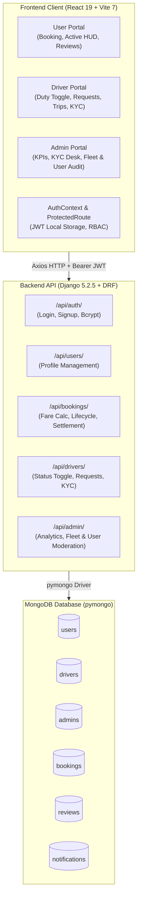
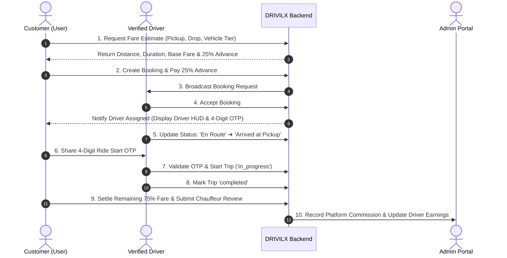

<div align="center">

# 🚗 DRIVILX
### *Next-Generation On-Demand Professional Driver & Chauffeur Platform*

[](https://www.djangoproject.com/)
[](https://www.django-rest-framework.org/)
[](https://react.dev/)
[](https://vitejs.dev/)
[](https://tailwindcss.com/)
[](https://www.mongodb.com/)
[](https://jwt.io/)
[](LICENSE)

<p align="center">
  A premium, full-stack chauffeur and driver booking ecosystem connecting vehicle owners with vetted, professional drivers on-demand. Designed with dedicated portals for <b>Customers</b>, <b>Drivers</b>, and <b>Platform Administrators</b>.
</p>

</div>

---

## 📋 Table of Contents

1. [Platform Overview](#-platform-overview)
2. [Key Portals & Features](#-key-portals--features)
   - [Customer Experience Portal](#1-customer-experience-portal)
   - [Driver Operations Portal](#2-driver-operations-portal)
   - [Admin Super-Control Portal](#3-admin-super-control-portal)
   - [Dynamic Animated Auth Suite](#4-dynamic-animated-auth-suite)
3. [System Architecture](#-system-architecture)
4. [Trip Lifecycle & Payment Workflow](#-trip-lifecycle--payment-workflow)
5. [Fare Calculation Engine](#-fare-calculation-engine)
6. [Tech Stack](#-tech-stack)
7. [Repository Structure](#-repository-structure)
8. [API Endpoints Reference](#-api-endpoints-reference)
9. [Installation & Setup](#-installation--setup)
10. [Environment Variables](#-environment-variables)
11. [Default Test Credentials](#-default-test-credentials)
12. [License & Acknowledgments](#-license--acknowledgments)

---

## 🌟 Platform Overview

**DRIVILX** solves the modern urban mobility challenge: *You have your own car, but need an experienced, trustworthy driver for city commutes, late-night events, outstation trips, or daily business travel.*

The platform offers:
- **Instant Driver Dispatch & Scheduling:** Fast assignment from a verified chauffeur pool.
- **Fair, Transparent Fare Engine:** Multi-parameter dynamic pricing based on trip duration, distance, and vehicle transmission/class.
- **Split Payment Workflow:** 25% advance commitment fee to lock in the driver, with remaining 75% settled post-trip completion.
- **Security & Trust:** Digital KYC verification for drivers, secure 4-digit ride start OTP, and two-way review system.
- **Role-Based Access Control (RBAC):** Distinct dashboards, state management, and protected routing for Users, Drivers, and Admins.

---

## 🚀 Key Portals & Features

### 1. Customer Experience Portal
* **Interactive Booking Modal:**
  - Fast destination selector with autocomplete for popular hubs (Airports, BKC, Business Districts).
  - Selection of 4 trip packages: **City Drive**, **Outstation Roundtrip**, **Hourly Chauffeur (4h / 8h)**, and **Night Drive Safe-Home**.
  - Vehicle classification support: **Hatchback (1.0x)**, **Sedan (1.15x)**, **SUV (1.35x)**, and **Luxury (1.75x)**.
* **Instant Fare Estimation:** Dynamic breakdown detailing base price, distance rate, estimated duration, 5% GST, advance deposit, and remaining balance.
* **Active Ride HUD (`ActiveTripCard`):**
  - Live lifecycle tracking: `Driver Assigned` ➔ `En Route` ➔ `Arrived at Location` ➔ `Trip In Progress` ➔ `Completed`.
  - Secure 4-digit OTP display to verify the assigned driver prior to departure.
  - Driver telemetry display: Driver avatar, name, rating, license badge, vehicle transmission specialties, and direct phone link.
* **Settlement & Ratings:**
  - One-click remaining balance payment (`PayRemainingModal`).
  - Interactive 5-star chauffeur review modal with written feedback (`ReviewModal`).
* **Notification Center:** Real-time push updates for trip status changes and payment receipts.

---

### 2. Driver Operations Portal
* **Availability Toggle:** Seamless online/offline duty switcher (`Available` / `Busy` / `Offline`) with real-time status sync.
* **Incoming Trip Requests:** Real-time modal displaying customer pickup location, destination, vehicle category, fare breakdown, and one-click Accept/Decline actions.
* **Active Trip Manager (`DriverActiveTripModal`):**
  - Stage-by-stage progression triggers: *Mark En Route* ➔ *Mark Arrived* ➔ *Enter Customer OTP to Start Ride* ➔ *Complete Trip*.
  - Direct call button to contact customer.
* **Digital KYC Verification (`DriverKYCModal`):**
  - Upload & verification system for Government Driving License, Aadhaar ID, Commercial Badge, and transmission expertise (Automatic, Manual, Luxury Sedan, Heavy SUV).
* **Earnings & Analytics (`DriverEarningsModal`):**
  - Gross earnings telemetry, completed trip count, platform commission deductions, and net payout tracking.
* **Trip History:** Full historical log of all completed journeys, earnings per ride, and customer ratings.

---

### 3. Admin Super-Control Portal
* **Executive KPI Dashboard:**
  - Real-time platform metrics: Total Registered Customers, Verified Driver Fleet, Completed Bookings, Gross Revenue, and Active Trips.
  - Interactive Annual/Monthly Revenue analytics chart and trip status distribution breakdown.
* **KYC Approvals Desk:**
  - Review pending driver KYC profiles, inspect license credentials, and approve or reject applications with instant notification dispatch.
* **User Management:**
  - Full roster of registered users with search, account status filtering, trip usage history, and instant **Suspend / Reactivate** controls.
* **Driver Fleet Operations:**
  - Complete driver fleet monitoring, ratings audit, current online status, and suspension toggles.
* **Central Booking Ledger:**
  - Real-time audit log of all bookings across every stage with financial splits (Total Fare, Advance Paid, Remaining Amount, Platform Commission).

---

### 4. Dynamic Animated Auth Suite
* **Interactive Night Highway Simulator (`AuthCarHero`):**
  - Custom SVG sports car featuring animated headlight beams, glowing roadway lines, and responsive speed telemetry.
  - Rotating live service highlights: Personal Chauffeur, Airport Transfers, Night-Out Safe Rides, and Outstation Tours.
* **Multi-Role Authentication:**
  - Single sign-on interface with automatic role redirection (`/user`, `/driver`, `/admin`).
  - Form validation, password visibility toggling, and JWT session persistence.
* **One-Click Demo Evaluator:**
  - Pre-filled credential options for swift portfolio and grading review without manual typing.

---

## 🏗️ System Architecture



---

## 🔄 Trip Lifecycle & Payment Workflow



---

## 🧮 Fare Calculation Engine

Fares are calculated dynamically in `apps/bookings/services.py` using calibrated base rates and vehicle multipliers:

### 1. Base Rates by Trip Type
| Trip Type | Base Price | Distance Rate | Ideal Use Case |
| :--- | :---: | :---: | :--- |
| **City Ride (`city_ride`)** | ₹199 | ₹14 / km | Daily office runs, errands, shopping |
| **Outstation Roundtrip (`outstation`)** | ₹499 | ₹16 / km | Weekend getaways & intercity business trips |
| **Hourly Chauffeur (`hourly`)** | ₹349 | ₹12 / km | Dedicated 4h / 8h chauffeur for meetings |
| **Night Drive Safe-Home (`night_ride`)** | ₹299 | ₹18 / km | Late-night safe ride back in your own vehicle |

### 2. Vehicle Class Multipliers
- **Hatchback:** `1.0x` (Compact city driving)
- **Sedan:** `1.15x` (Executive sedans, Honda City, Ciaz)
- **SUV:** `1.35x` (Large vehicles, Innova, Creta, XUV700)
- **Luxury:** `1.75x` (Mercedes-Benz, BMW, Audi VIP chauffeurs)

### 3. Pricing Formula
$$\text{Subtotal} = \Big(\text{Base Price} + (\text{Distance (km)} \times \text{Rate/km}) + \left(\frac{\text{Duration (mins)}}{60} \times ₹50\right)\Big) \times \text{Vehicle Multiplier}$$

$$\text{GST} = \text{Subtotal} \times 0.05 \quad (5\%)$$

$$\text{Total Fare} = \text{Round}(\text{Subtotal} + \text{GST})$$

$$\text{Advance Deposit (25\%)} = \text{Round}(\text{Total Fare} \times 0.25) \qquad \text{Remaining Balance (75\%)} = \text{Total Fare} - \text{Advance Deposit}$$

---

## 💻 Tech Stack

### Frontend Architecture
| Layer | Technology | Details |
| :--- | :--- | :--- |
| **Runtime & Bundler** | [Vite 7.1](https://vitejs.dev/) | Ultra-fast HMR and optimized production bundling |
| **UI Library** | [React 19.1](https://react.dev/) | Functional components with Hooks, Context API |
| **Styling** | [TailwindCSS 4.3](https://tailwindcss.com/) + `@tailwindcss/vite` | Modern utility-first CSS with customized neon-dark aesthetics |
| **Icons** | [Lucide React 0.468](https://lucide.dev/) | Modern, clean iconography |
| **Routing** | [React Router DOM 7.8](https://reactrouter.com/) | Client-side routing with protected RBAC guards |
| **HTTP Client** | [Axios 1.11](https://axios-http.com/) | Configured API interceptors with JWT Bearer headers |

### Backend Architecture
| Layer | Technology | Details |
| :--- | :--- | :--- |
| **Web Framework** | [Django 5.2.5](https://www.djangoproject.com/) | High-level Python web framework |
| **REST API** | [Django REST Framework 3.16](https://www.django-rest-framework.org/) | Robust serialization and Class-Based APIViews |
| **Database Driver** | [PyMongo 4.14](https://pymongo.readthedocs.io/) | Native, high-performance MongoDB driver |
| **Security & Auth** | [PyJWT 2.10](https://pyjwt.readthedocs.io/) + [Bcrypt 4.3](https://pypi.org/project/bcrypt/) | Stateless JWT token issuance and salted password hashing |
| **CORS Middleware** | [django-cors-headers 4.7](https://github.com/adamchainz/django-cors-headers) | Secure Cross-Origin resource sharing |
| **Configuration** | [python-dotenv 1.1](https://pypi.org/project/python-dotenv/) | Environment variable management |

### Database Collections (MongoDB)
- `users`: Customer credentials, contact details, account status (`active` / `suspended`), profile timestamps.
- `drivers`: Professional credentials, ratings, total trips, vehicle transmission experience, KYC records, duty status (`available` / `busy` / `offline`).
- `admins`: Platform administrative credentials with elevated privileges.
- `bookings`: Complete ride lifecycle logs, route info, calculated fares, advance/remaining payment records, assigned chauffeur, ride OTP.
- `reviews`: Customer ratings (1-5 stars), written feedback, reviewer and driver references.
- `notifications`: User-specific in-app alerts and timestamped status events.

---

## 📂 Repository Structure

```
DRIVILX/
├── backend/
│   ├── apps/
│   │   ├── admin_portal/       # Super-Admin analytics, user & driver management, KYC
│   │   │   ├── urls.py
│   │   │   └── views.py
│   │   ├── authentication/     # JWT login, registration & password hashing
│   │   │   ├── urls.py
│   │   │   └── views.py
│   │   ├── bookings/           # Fare estimation, booking state machine, OTP & reviews
│   │   │   ├── services.py     # Fare calculation & driver allocation algorithms
│   │   │   ├── urls.py
│   │   │   └── views.py
│   │   ├── drivers/            # Driver profile, duty toggle, incoming requests, earnings
│   │   │   ├── urls.py
│   │   │   └── views.py
│   │   └── users/              # Customer profile management & authentication helpers
│   │       ├── urls.py
│   │       └── views.py
│   ├── config/
│   │   ├── asgi.py
│   │   ├── settings.py         # Installed apps, CORS headers, JWT secret configuration
│   │   ├── urls.py             # Root routing configuration
│   │   └── wsgi.py
│   ├── database/
│   │   └── mongodb.py          # PyMongo connection pool, index creations & auto-seeders
│   ├── .env                    # Backend environment config
│   ├── manage.py               # Django CLI management script
│   └── requirements.txt        # Python dependency manifest
│
└── frontend/
    ├── src/
    │   ├── components/
    │   │   ├── common/         # AuthCarHero animation, ProtectedRoute guards
    │   │   ├── driver/         # ActiveTrip, Earnings, KYC, Requests, Profile modals
    │   │   ├── navbar/         # Universal role-adaptive navigation header
    │   │   └── user/           # BookingModal, ActiveTripCard, PayRemaining, ReviewModal
    │   ├── context/
    │   │   └── AuthContext.jsx # Global auth provider, role persistence & logout logic
    │   ├── pages/
    │   │   ├── admin/          # AdminHome comprehensive dashboard
    │   │   ├── auth/           # Login & Signup with dynamic car animations
    │   │   ├── driver/         # DriverHome dashboard
    │   │   └── user/           # UserHome customer booking experience
    │   ├── routes/
    │   │   └── AppRoutes.jsx   # React Router route registry with RBAC guards
    │   ├── services/           # Axios API services (auth, bookings, drivers, admin, user)
    │   ├── App.jsx
    │   ├── index.css           # TailwindCSS custom animations, glowing telemetry & fonts
    │   └── main.jsx
    ├── .env                    # Frontend Vite environment config
    ├── index.html              # HTML5 root with custom fonts
    ├── package.json            # Node.js dependencies & scripts
    └── vite.config.js          # Vite bundler configuration
```

---

## 📡 API Endpoints Reference

### 1. Authentication (`/api/auth/`)
| Method | Endpoint | Description |
| :--- | :--- | :--- |
| `POST` | `/api/auth/login/` | Authenticate user, driver, or admin; returns JWT token & user payload |
| `POST` | `/api/auth/signup/` | Register new customer or driver account |

### 2. User & Profile (`/api/users/`)
| Method | Endpoint | Description |
| :--- | :--- | :--- |
| `GET` | `/api/users/profile/` | Fetch current authenticated user's profile details |
| `PUT` | `/api/users/profile/` | Update customer phone number or name |

### 3. Bookings & Rides (`/api/bookings/`)
| Method | Endpoint | Description |
| :--- | :--- | :--- |
| `POST` | `/api/bookings/estimate/` | Calculate real-time estimated fare with breakdown |
| `POST` | `/api/bookings/create/` | Create booking, generate OTP & deduct 25% advance |
| `GET` | `/api/bookings/my-bookings/` | Fetch customer booking history and active trips |
| `GET` | `/api/bookings/<booking_id>/` | Fetch single booking status and details |
| `POST` | `/api/bookings/<booking_id>/pay-advance/` | Process 25% advance commitment payment |
| `POST` | `/api/bookings/<booking_id>/pay-remaining/` | Settle 75% remaining fare post-completion |
| `POST` | `/api/bookings/<booking_id>/review/` | Submit 1-5 star rating and feedback for driver |
| `POST` | `/api/bookings/<booking_id>/update-status/`| Update trip lifecycle state (En Route, Arrived, In Progress, Completed) |
| `GET` | `/api/bookings/notifications/list/` | Retrieve user notification inbox |
| `POST` | `/api/bookings/notifications/read-all/` | Mark all notifications as read |

### 4. Driver Operations (`/api/drivers/`)
| Method | Endpoint | Description |
| :--- | :--- | :--- |
| `GET` | `/api/drivers/profile/` | Retrieve driver profile, metrics, ratings & badge |
| `POST` | `/api/drivers/toggle-status/` | Toggle duty status (`available` / `offline`) |
| `POST` | `/api/drivers/kyc/` | Submit or update driver KYC documents |
| `GET` | `/api/drivers/requests/` | Fetch incoming booking requests available to accept |
| `POST` | `/api/drivers/requests/<booking_id>/action/` | Accept or reject incoming ride request |
| `GET` | `/api/drivers/trips/active/` | Get current active trip being serviced |
| `GET` | `/api/drivers/trips/history/` | Get full history of completed trips |
| `GET` | `/api/drivers/earnings/` | Get gross earnings, trip counts, and commission deductions |

### 5. Admin Super-Portal (`/api/admin/`)
| Method | Endpoint | Description |
| :--- | :--- | :--- |
| `GET` | `/api/admin/analytics/` | Fetch aggregated platform KPIs, revenue chart & status metrics |
| `GET` | `/api/admin/users/` | List all registered customers with search & filter |
| `GET` | `/api/admin/users/<user_id>/` | View user profile and booking history |
| `POST` | `/api/admin/users/<user_id>/suspend/` | Toggle customer suspension status |
| `GET` | `/api/admin/drivers/` | List all drivers with KYC and duty status |
| `GET` | `/api/admin/drivers/<driver_id>/` | View driver details, ratings, and trips |
| `POST` | `/api/admin/drivers/<driver_id>/suspend/` | Toggle driver suspension status |
| `POST` | `/api/admin/drivers/<driver_id>/kyc/` | Approve or reject submitted driver KYC |
| `GET` | `/api/admin/bookings/` | View all platform bookings with status filter |

---

## ⚙️ Installation & Setup

### Prerequisites
- **Python:** Version 3.10 or higher
- **Node.js:** Version 18 or higher (with `npm`)
- **MongoDB:** MongoDB Community Server running locally on port `27017` (or a MongoDB Atlas connection URI)

---

### 1. Database Setup
Ensure your MongoDB service is running:
```bash
# Windows (PowerShell - if installed as service)
net start MongoDB

# Linux / macOS
sudo systemctl start mongod
# or with brew:
brew services start mongodb-community
```

---

### 2. Backend Setup

1. **Open a terminal and navigate to the backend directory:**
   ```bash
   cd backend
   ```

2. **Create a Python virtual environment:**
   ```bash
   # Windows
   python -m venv .venv
   .venv\Scripts\activate

   # macOS / Linux
   python3 -m venv .venv
   source .venv/bin/activate
   ```

3. **Install dependencies:**
   ```bash
   pip install -r requirements.txt
   ```

4. **Verify environment variables in `backend/.env`:**
   ```env
   SECRET_KEY=drivilx-django-secret-key
   DEBUG=True
   MONGO_URI=mongodb://localhost:27017/
   MONGO_DB_NAME=drivilx
   JWT_SECRET=drivilx-jwt-secret-key
   ADMIN_EMAIL=admin@drivilx.com
   ADMIN_PASSWORD=Admin@12345
   ```

5. **Start the Django development server:**
   ```bash
   python manage.py runserver
   ```
   > ℹ️ *On server initialization, `database/mongodb.py` automatically initializes collections and seeds the default admin, driver, and user accounts.*

   *The API will be accessible at: **`http://localhost:8000/`***

---

### 3. Frontend Setup

1. **Open a separate terminal and navigate to the frontend directory:**
   ```bash
   cd frontend
   ```

2. **Install Node.js dependencies:**
   ```bash
   npm install
   ```

3. **Verify environment configuration in `frontend/.env`:**
   ```env
   VITE_API_URL=http://localhost:8000/api
   ```

4. **Launch the Vite development server:**
   ```bash
   npm run dev
   ```

   *The frontend client will be available at: **`http://localhost:5173/`***

---

## 🔑 Default Test Credentials

The database is pre-seeded on startup with verified accounts for evaluation:

| Portal Role | Email Address | Password | Permissions & Scope |
| :--- | :--- | :--- | :--- |
| **🛡️ Administrator** | `admin123@gmail.com` | `admin@1234` | Full access to KPI analytics, KYC approvals, user/driver moderation, booking ledger |
| **🚗 Customer (User)** | `user123@gmail.com` | `user@1234` | Search & book chauffeurs, live tracking HUD, OTP sharing, payment settlement & reviews |
| **👨‍✈️ Verified Driver** | `rajesh.driver@drivilx.com` | `driver@1234` | Duty toggle, accept booking requests, OTP verification, trip management, earnings |

> 💡 **Tip:** On the [Sign In page](http://localhost:5173/login), you can switch between customer and driver roles or use the demo credentials directly.

---

## 🧪 Testing the Complete Trip Flow

To test the entire workflow end-to-end:

1. **Step 1: Customer Booking**
   - Log in as Customer (`user123@gmail.com` / `user@1234`).
   - Click **Book Driver Now**. Select pickup, destination, trip type (e.g., *City Drive*), and vehicle category (e.g., *Sedan*).
   - Review estimated fare and click **Confirm & Pay Advance (25%)**.
   - Note the **4-digit Ride Start OTP** displayed on your Active Trip card.

2. **Step 2: Driver Trip Handling**
   - In an incognito tab or separate browser, log in as Driver (`rajesh.driver@drivilx.com` / `driver@1234`).
   - Ensure status is set to **Online & Available**.
   - Open **Incoming Requests**, review the booking, and click **Accept Request**.
   - Open **Active Trip**:
     - Click **Mark En Route**.
     - Click **Mark Arrived**.
     - Enter the Customer's **4-digit OTP** and click **Start Trip**.
     - Click **Complete Trip**.

3. **Step 3: Settlement & Review**
   - Return to the Customer portal.
   - Click **Pay Remaining (75%)** to settle the final amount.
   - Submit a 5-star rating and written review for Rajesh Kumar.

4. **Step 4: Admin Audit**
   - Log in as Admin (`admin123@gmail.com` / `admin@1234`).
   - Open the **Analytics** and **Bookings** tabs to observe the updated revenue, completed ride tally, and platform commission.

---

## 📄 License & Acknowledgments

- Built as a full-stack **Capstone Project (SEM 9)**.
- Licensed under the [MIT License](LICENSE).
- Built with ❤️ using Django, React, TailwindCSS, and MongoDB.
